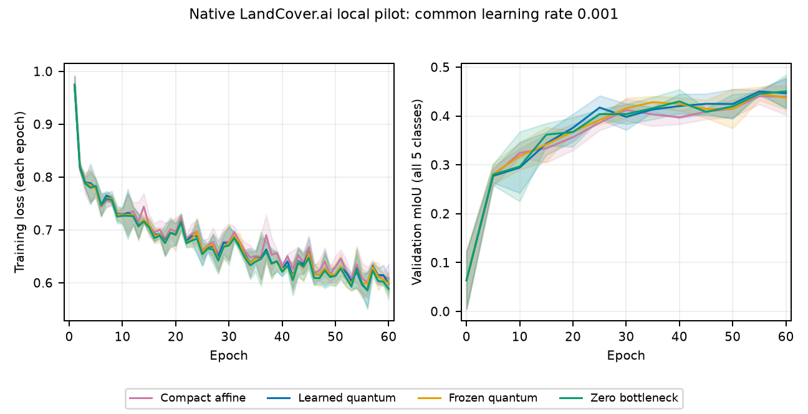

# Native LandCover.ai: a small learned-circuit signal, no clear classical gain

Using the paper's native five-class dataset did **not produce a convincing
quantum improvement in this bounded comparison**. Learned quantum reached
46.06% validation mIoU, versus 45.90% for affine and 46.05% when the reconstructed
deepest path was zeroed. Its paired gain over affine was only **+0.157 percentage
points**, positive in two of three seeds. The predefined improvement screen failed.

A limited positive observation is that learned quantum exceeded frozen quantum
in all three seeds, averaging **+0.818 pp**. Calibration seed 42 dominated that
difference; follow-up seeds 77/123 averaged +0.283 pp, and seed 77 differed by
only +0.008 pp. This offers a small signal for circuit training, without
establishing a useful quantum advantage.

All twelve primary fits improved over initialization, but **all twelve selected
checkpoints were at epoch 55 or 60**. The training horizon remains unresolved.
These validation-selected results on a fixed small cohort are not an exact
reproduction or refutation of the paper's full-test score.

| Control | Validation mIoU, % ± sample SD | Overall accuracy, % ± sample SD | Foreground mIoU, % ± sample SD |
|---|---:|---:|---:|
| Compact affine | 45.90 ± 0.42 | 85.35 ± 0.30 | 37.57 ± 0.49 |
| Learned quantum | 46.06 ± 0.78 | 85.80 ± 0.90 | 37.58 ± 0.71 |
| Frozen quantum | 45.24 ± 0.22 | 85.44 ± 1.02 | 36.79 ± 0.59 |
| Zero bottleneck | 46.05 ± 1.67 | 86.24 ± 1.17 | 37.44 ± 1.67 |

Primary mIoU pools each model's 1,024 validation crops into one integer confusion
matrix, then averages all five class IoUs, including background. Foreground-only
mIoU is secondary; it also shows little quantum improvement over affine here.
SD measures three training seeds on one cohort, not independent dataset/pixel
uncertainty.

| Quantum minus control, pp | Seed 42 (calibration) | Seed 77 | Seed 123 | Paired mean ± sample SD | Follow-up seeds 77/123 mean |
|---|---:|---:|---:|---:|---:|
| Compact affine | +0.504 | −0.256 | +0.223 | +0.157 ± 0.384 | −0.017 |
| Frozen quantum | +1.889 | +0.008 | +0.558 | +0.818 ± 0.967 | +0.283 |
| Zero bottleneck | +0.508 | +1.070 | −1.552 | +0.009 ± 1.381 | −0.241 |

Differences are computed within each seed before taking mean and sample SD.
The prospective screen required at least +1 pp mean improvement over both affine
and frozen quantum, positive differences in every seed against each, and a
nonnegative mean against zero. This is descriptive, not a significance or
equivalence test. A competitive separately trained zero control does not prove
that the trained quantum model ignores its circuit; that needs an intervention.

Lines are means and bands sample SD over all three seeds at common LR 0.001.
Training loss is recorded every epoch; validation every five epochs. Curves use
each epoch's model; tables use each fit's earliest strict-best validation checkpoint.
Both the actual [PDF](exports/learning_curves.pdf) and PNG were visually inspected.

The core parameter reduction is negligible at whole-model scale: quantum stores
8,154,283 parameters versus 8,155,843 for affine, a difference of 1,560 (0.019%).
Their cores have 8 and 1,568 parameters. Both share the full-width CNN/interfaces.
Frozen quantum retains input gradients into the encoder. Zero retains ordinary
U-Net skips but zeros the reconstructed deepest path; trainable flags do not count
only parameters that functionally affect its output.

Mean primary-fit elapsed times were 79.3 minutes for learned quantum, 75.3 for
frozen quantum, 7.4 for affine and 7.1 for zero. Quantum took about 10.7 times the
affine elapsed cost on this local CPU-statevector/CUDA-CNN setup, including periodic
validation. This is simulator cost, not hardware quantum performance.
[Actual fit costs](exports/fit_costs.csv) are distinct from the synthetic warmed
[profile](exports/profile_costs.csv). Training, replay and export finished within the frozen 24-hour
deadline under the 6 GiB/no-swap, two-thread and 12% GPU allocator limits.

The useful next experiment is prospectively longer matched-control training with
an independent evaluation design, rather than an architectural claim based on
these tiny differences. Alan owns any Anvil execution; no Anvil job was run here.

Frozen design and interpretation limits

This independent implementation follows the native dataset/task and explicit
diagram choices in [HQ-UNet, arXiv:2604.27206v1](https://arxiv.org/html/2604.27206v1).
The paper lacks sufficient split/training/code details for exact replication;
its diagram/prose also leave the fourth convolution ambiguous. The
[unchanged protocol](../../docs/LANDCOVER_NATIVE_PROTOCOL.md) documents the
64/128/256/512/1024 widths, fourth down block, full 16-qubit brickwork circuit,
32 measurements and dense reconstruction. Relative to our earlier binary DFC24
adaptation, dataset, task, width and circuit scheduling changed together, so this
cannot isolate dataset effects alone.

Official LandCover.ai v1 has 7,470 training and 1,602 validation tiles. This local
study uses fixed SHA-ranked subsets of 256 and 64. Each validation tile is fully
evaluated as sixteen nonoverlapping 128 crops: 16,777,216 pixels per model.
Training uses one paired deterministic random 128 crop and D4 transform per tile
per epoch. Labels remain background, building, woodland, water and road. Test
windows were neither prepared nor evaluated; test IDs and archive-byte hashing
are not test evaluation.

All 35 selected validation parent orthophotos occur in selected training. The
[independent cohort audit](cohort/REPORT.md) verifies all 640 selected PNG hashes
and decoded values/counts, finds no exact full-tile RGB or RGB-plus-mask duplicates,
and matches sixteen sampled original TIFF windows. This does not establish
absence of near duplicates or geographic independence.

Seeds 42/77/123 share cohorts, non-core initial tensors and observed crop/order/D4
schedules. Each fit uses 60 epochs, batch 4 and 3,840 Adam updates. Loss equally
weights unweighted cross entropy and five-class macro soft Dice. Common LR 0.001
was selected from 0.001/0.003 using only affine seed 42 before quantum fitting.
Reusing the selected affine fit gives 13 fits and 12 primary rows. No post-result
extra fits or tuning occurred. This recipe does not establish an independently
optimized quantum learning rate. Validation served rate and checkpoint selection;
the three-seed average includes calibration. No independent-test, significance,
equivalence, geographic-generalization, general quantum-superiority, hardware
speedup, federated or Anvil claim follows.

Evidence, independent audit and reproducibility

Implementation [PR #66](https://github.com/SECQUOIA/QUAFFLE/pull/66) merged at
`604cef0e164bf1ba2be301b82107ddbb0fb39a90`. All executable/protocol bytes remained
unchanged during fitting, replay and export. The prior full local suite passed
**874 tests** on those unchanged bytes; this is not a fresh hosted-CI run.
Historical simulator bytes/hash guards remain intact; native full-16-qubit output
and derivative checks use independent PennyLane definitions.
[Preflight evidence](../landcover_native_preflight_20261028/) retains those checks
and original Astra assessments.

Immutable [plan](plan.json) SHA256:
`a3cae54c1f575fc46722513c8d274daf96ef4b3fc4635c4a3e051c7f6e1b30fc`.
Official archive SHA256:
`dd448287ff3a76291f2b159084b8a265f2ba4559bb80b0551fc8c6c0eb149a4b`.
[Raw numeric records](raw/) retain all thirteen fits, full training and periodic
validation histories, selected checkpoint hashes, twelve actual strict checkpoint
restorations/replays, inference intents and runtime/config bindings.

The [standalone numerical audit](numeric_audit/completed_v1/REPORT.md) reconciled
169 original validation count points, 793 training-history points, 12 selected
replays and every cell of ten CSV tables. It independently computed all five
class IoUs, accuracy, foreground mIoU, paired mean/sample SD, calibration/follow-up
contrasts and the screen using exact rational thresholds. It hashed thirteen
actual checkpoint files without loading models; the separate collector performed
real checkpoint forward replay. Its source/selfchecks were retained before outcomes.

Two complete 17-file exports were byte-identical, including PDF/PNG. Actual
completed-path tripwires confirmed no repeated fitting or inference, with all
campaign/replay file bytes and mtimes unchanged. The
[operational verification](operations/completed_v1/pipeline_verification.json)
and [publication manifest](publication_manifest.json) bind the original artifacts.
All original export bytes are preserved under [exports/](exports/).

No imagery, weights or prediction arrays are committed. The unchanged exporter
performs no inference but audits checkpoint file hashes, so its exact rerun or the
full local audit requires retained local metadata, weights and cache layout.
Published raw confusion counts/tables support independent numeric recomputation;
the Git package alone does not support model replay. Local originals remain retained.

