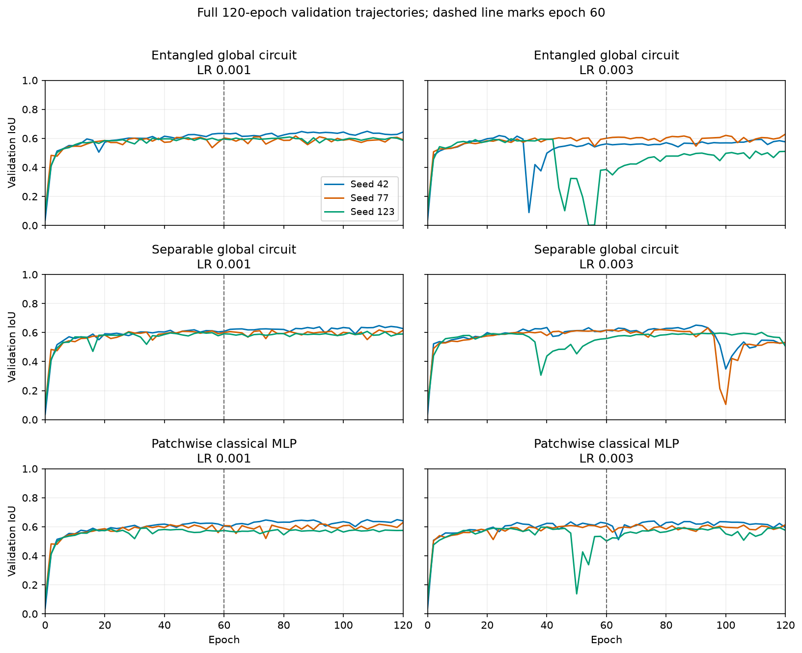
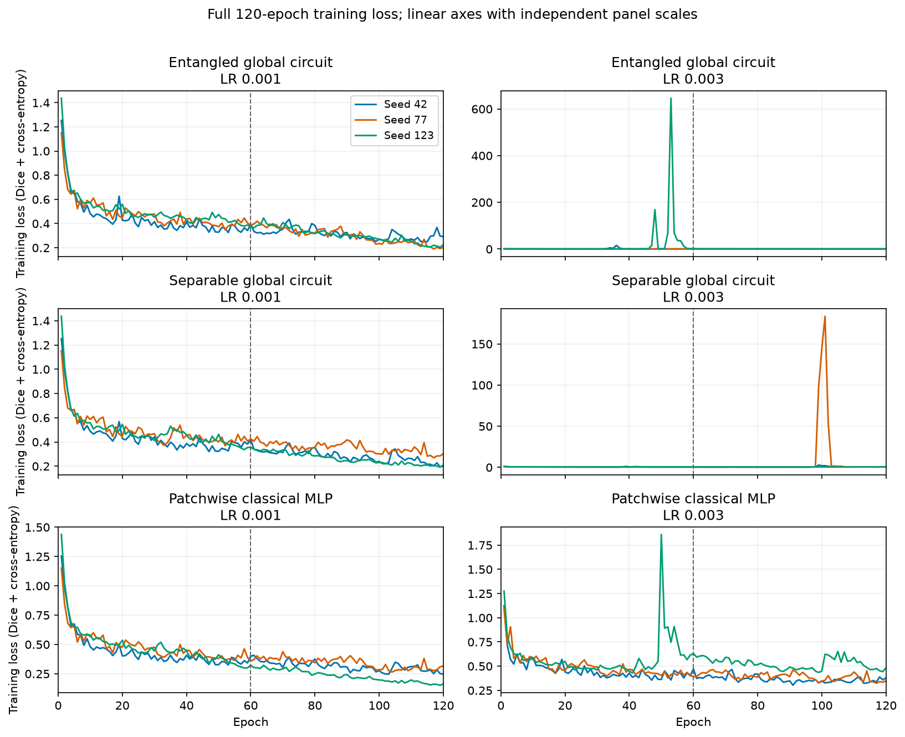
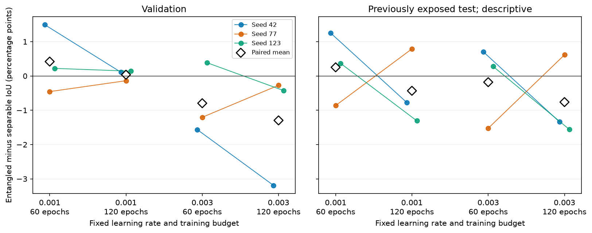

# Local rate and duration study

The study completes 12 matched60 cells (eight audited historical fits and four new fits) and 18 fresh 120-epoch cells.
Validation is the development metric. The previously inspected test split is descriptive, not an untouched confirmation set.
All models use 64-pixel images, 128 optimization tiles, global-fit normalization excluding validation, and three paired seeds.
The patchwise MLP is the strongest observed original classical control; its bottleneck spatial operation differs from the globally pooled circuits. Encoder and attention context remain unchanged.

[60-epoch fixed-rate tables](matched60/README.md) · [120-epoch fixed-rate tables](long120/README.md)

| Model | Fixed LR | Metric | 120 minus 60 IoU percentage points, mean ± sample SD | Wins |
| --- | ---: | --- | ---: | ---: |
| quantum_global | 0.001 | Validation | +0.990 ± 0.471 | 3/3 |
| quantum_global | 0.003 | Validation | +0.826 ± 1.430 | 1/3 |
| quantum_no_entanglement_global | 0.001 | Validation | +1.373 ± 1.290 | 3/3 |
| quantum_no_entanglement_global | 0.003 | Validation | +1.326 ± 0.451 | 3/3 |
| quantum_global | 0.001 | Descriptive test | +1.411 ± 0.620 | 3/3 |
| quantum_global | 0.003 | Descriptive test | +0.472 ± 0.818 | 1/3 |
| quantum_no_entanglement_global | 0.001 | Descriptive test | +2.096 ± 1.708 | 3/3 |
| quantum_no_entanglement_global | 0.003 | Descriptive test | +1.054 ± 1.543 | 2/3 |

The first 60-epoch history is exactly identical in 0/12 matching quantum cells; validation classification counts are identical in 12/12.
[The prefix audit](prefix60_comparison.json) lists every training-loss and validation-metric difference without numerical suppression.
The independently rerun prefixes differ. Duration contrasts therefore include that observed trajectory variation; they must not be attributed solely to extra epochs.

[Descriptive loss and checkpoint summaries](STABILITY.md) retain every cell. The training-loss panels use independent linear y scales. An initially high loss is not automatically instability; the maximum after epoch 10 is a specified summary, not a diagnostic threshold.

Points show every paired seed; black diamonds show paired means. Connecting lines link the same seed/rate across training budgets.
The full 120-epoch best-validation score includes the first 60 epochs by construction; that within-trajectory increase alone is not independent replication.
All raw histories, parameter/gradient diagnostics, per-sensor metrics, checkpoint hashes and producer identities are retained. No significance, equivalence, computational advantage, Anvil or physical-hardware claim follows from this pilot.
